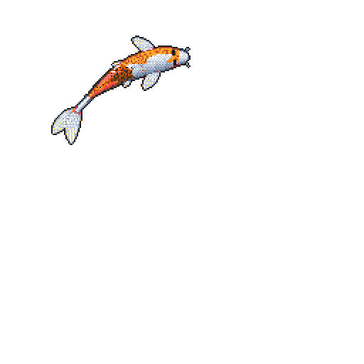

- 👋 Hi, I’m @HasanPekedis

- 💼 Currently working as an AI/ML Engineer at DNA Proje ve Yazılım A.Ş.

- 🏢 From Marmara University Computer Engineering

- 🖥️ Enjoy coding

- 🧩 Latest side project: [Masonry for TasksBoard](https://github.com/HasanPekedis/tasksboard-masonry), a Chrome extension that lays out TasksBoard lists as a masonry grid

- 📫 How to reach me: hasanpekedis365@hotmail.com

- 🧿 My Personal Website: https://hasanpekedis.github.io/

  

